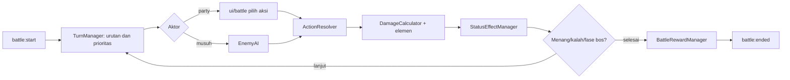

# Turn-based Battle Architecture

Modul (di `systems/battle`, `systems/enemy-ai`, `systems/skills`, `systems/status-effects`): BattleManager (siklus hidup), TurnManager (urutan dan prioritas), ActionResolver (menjalankan aksi), DamageCalculator (rumus, elemen), TargetSelector, StatusEffectManager, SkillManager, EnemyAI, BattleRewardManager, BattleStateManager (state murni, bisa diserialisasi untuk tes).

Mendukung party, prioritas aksi, target, elemen, buff, debuff, status, skill, item, fase bos, menang dan kalah. Semua aturan dibaca dari data `content/combat` dan `content/creatures`. Battle logic tidak boleh menyentuh Canvas; render dilakukan `BattleScene` dan `ui/battle`. RNG diberi seed agar tes deterministik.
