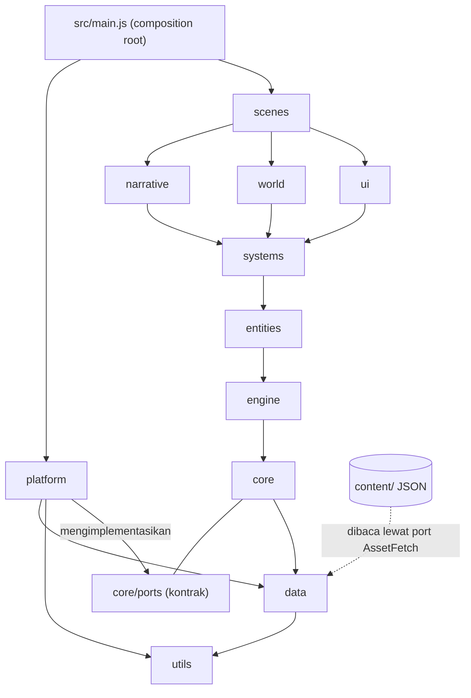

# Technical Architecture

## 1. Lapisan, port, dan arah dependensi

Panah berarti "mengimpor". Lapisan atas boleh mengimpor lapisan di bawahnya, tidak pernah sebaliknya.



`core` hanya mengenal **port**: kontrak (interface) di `src/core/ports/`, ditulis sebagai JSDoc typedef dengan pemeriksa bentuk saat runtime. `platform` mengimplementasikan port itu dengan API browser. Satu-satunya tempat yang mengenal keduanya adalah `src/main.js` (composition root): ia membuat adapter nyata lalu menyuntikkannya ke `Game` lewat konstruktor.

| Port (di core/ports) | Dipakai oleh | Adapter nyata (di platform) | Pengganti untuk tes |
| --- | --- | --- | --- |
| ClockPort (`now`) | GameLoop, animasi | `browser/BrowserClock` | jam palsu |
| FrameSchedulerPort (`request`, `cancel`) | GameLoop | `browser/RafScheduler` | penjadwal manual |
| ViewportPort (ukuran, dpr, orientasi, `onResize`) | Renderer, kamera | `browser/BrowserViewport` | viewport palsu |
| RenderSurfacePort (konteks 2D, ukuran CSS) | engine/rendering | `browser/CanvasSurface` | surface palsu |
| InputSourcePort (event input ternormalisasi) | engine/input | `browser/KeyboardAdapter`, `mobile/TouchAdapter` | sumber palsu |
| StoragePort (`get`, `put`, `delete`, `list`, async) | systems/save | `storage/IndexedDbStorageAdapter`, `storage/MemoryStorageAdapter` | memori |
| AssetFetchPort (`json`, `binary`, basis URL) | AssetManager, loader | `browser/FetchAssetLoader` | data dalam memori |
| AudioPort (`play`, `stop`, `unlock`) | engine/audio | `browser/WebAudioAdapter` | audio diam |
| OfflinePort (status, pembaruan versi) | systems/offline | `pwa/ServiceWorkerAdapter` | status palsu |

Cara core mengakses kemampuan platform tanpa mengenal browser: `GameLoop` memanggil `scheduler.request(cb)` dan `clock.now()` dari port yang diterimanya; ia tidak tahu apakah itu `requestAnimationFrame`. `systems/save` memanggil `storage.put(...)`; ia tidak tahu apakah di baliknya IndexedDB, memori, atau berkas. Akibatnya semua kode di `core`, `engine`, `systems` dapat diuji dengan `node --test` memakai pengganti, tanpa browser.

Aturan impor (ditegakkan oleh `tools/validate-project.mjs`, status per aturan tercantum di bagian 8):
1. Lapisan bawah tidak mengimpor lapisan atas. Peringkat: utils 0, data 1, core 2, engine 3, entities 4, systems 5, world dan narrative 6, ui 7, scenes 8.
2. `core` tidak mengimpor `platform`. Hanya `src/main.js` yang boleh mengimpor `platform`.
3. `platform` hanya boleh mengimpor `utils`, `data`, dan `core/ports`.
4. API browser (`window`, `document`, `indexedDB`, `localStorage`, `navigator`, `requestAnimationFrame`, `performance.now`) hanya muncul di `platform/` dan `main.js`. Pembuatan elemen DOM juga hanya di `platform`.
5. Tanpa impor bare (tanpa dependensi npm) di `src/`.
6. Tanpa siklus impor.
7. Antar-sistem selevel berkomunikasi lewat `EventBus`.
8. `content/` hanya data; kode tidak berisi nama karakter, wilayah, atau item.
9. Tanpa global state; state di `StateManager` dan diberikan lewat konstruktor.

## 2. Aturan EventBus
Nama event `domain:aksi` (contoh `battle:ended`, `quest:updated`). Payload objek polos yang bisa diserialisasi. Pelanggan wajib berhenti berlangganan saat scene/sistem dibuang. Event bukan pengganti pemanggilan langsung untuk hubungan induk-anak yang jelas.

## 3. Pengelompokan sistem
**Core** (dibutuhkan vertical slice, Batch 1-19): world, exploration, interaction, dialogue, quest, battle, enemy-ai, party, character-progression, inventory, equipment, skills, magic, elemental, status-effects, economy, shops, save, offline. Alasan: tanpa ini JRPG tidak bisa dimainkan dari awal sampai akhir.
**Planned** (setelah slice, desain data sudah menyisakan ruang): crafting, gathering, achievements, reputation, factions, calendar, weather, bestiary, journal, difficulty, lighting. Alasan: memperkaya tetapi tidak memblokir loop utama; sebagian bergantung pada konten.
**Optional expansion**: relationships (companion), New Game Plus, secret areas, hidden treasure, companion progression lanjut, localization di luar id/en. Alasan: nilai tinggi tetapi biaya desain dan QA besar; dikerjakan bila slice stabil.

## 4. Matriks tanggung jawab folder
| Folder | Tanggung jawab | Tidak boleh |
| --- | --- | --- |
| core | Siklus game, scene, event, aset, state, config, log, dan kontrak port | Berisi aturan game atau mengimpor platform |
| engine | Render, animasi, fisika, tabrakan, kamera, input, audio, partikel, jalur, cahaya, tilemap | Mengenal konten spesifik |
| scenes | Satu layar/mode permainan, orkestrasi | Menyimpan aturan inti |
| entities | Bentuk objek dunia (pemain, NPC, monster) dari data | Hardcode data |
| systems | Aturan dan mekanik | Menggambar langsung |
| world | Hierarki WORLD, REGION, ZONE, MAP, LOCATION; muat zona; transisi; spawn | Aturan battle |
| narrative | Cerita, bab, quest, dialog, pilihan, flag, cutscene, jurnal | Render |
| ui | Komponen, HUD, menu, kontrol sentuh | Mengubah state tanpa lewat sistem |
| data | Schema, validator, registry, loader, migrasi data | Logika gameplay |
| platform | Adapter yang mengimplementasikan port core (browser, mobile, storage, PWA) | Aturan game; diimpor selain oleh src/main.js |
| utils | Fungsi murni umum | Impor lapisan atas |
| content | Data JSON game | Kode |
| assets | Gambar, audio, font | Data aturan |
| tools | Generator dan editor offline pengembang | Dimuat oleh game runtime |
| tests | Uji | Logika produksi |

## 5. Pohon folder resmi
`[TARGET]` = belum dibuat; folder dibuat saat berisi file nyata. `[ADA]` = sudah ada.

```
jrpg-project/
├── index.html  [ADA]
├── README.md, LICENSE, manifest.json, .nojekyll, package.json, jsconfig.json, .gitignore  [ADA]
├── .github/workflows/{deploy.yml,quality-check.yml}  [ADA]
├── docs/  [SEBAGIAN ADA, lihat docs/INDEX.md]
├── legacy/  [ADA: prototype v2, dibekukan]
├── tools/validate-project.mjs  [ADA]
├── src/main.js  [TARGET: composition root, Batch 1]
├── src/core/  [TARGET]
│   ├── Game
│   ├── GameLoop
│   ├── SceneManager
│   ├── EventBus
│   ├── AssetManager
│   ├── ResourceManager
│   ├── StateManager
│   ├── Config
│   ├── Logger
│   ├── ports/  (kontrak: Clock, FrameScheduler, Viewport, RenderSurface, InputSource, Storage, AssetFetch, Audio, Offline)
├── src/engine/  [TARGET]
│   ├── rendering
│   ├── animation
│   ├── physics
│   ├── collision
│   ├── camera
│   ├── input
│   ├── audio
│   ├── particles
│   ├── pathfinding
│   ├── lighting
│   ├── tilemap
├── src/scenes/  [TARGET]
│   ├── Boot
│   ├── Loading
│   ├── Title
│   ├── MainMenu
│   ├── World
│   ├── Battle
│   ├── Dialogue
│   ├── Shop
│   ├── Dungeon
│   ├── Cutscene
│   ├── GameOver
│   ├── Credits
├── src/entities/  [TARGET]
│   ├── base
│   ├── player
│   ├── party
│   ├── npc
│   ├── monsters
│   ├── bosses
│   ├── interactables
│   ├── projectiles
├── src/systems/  [TARGET]
│   ├── world
│   ├── exploration
│   ├── interaction
│   ├── dialogue
│   ├── quest
│   ├── battle
│   ├── enemy-ai
│   ├── party
│   ├── character-progression
│   ├── inventory
│   ├── equipment
│   ├── skills
│   ├── magic
│   ├── elemental
│   ├── status-effects
│   ├── crafting
│   ├── gathering
│   ├── economy
│   ├── shops
│   ├── achievements
│   ├── reputation
│   ├── factions
│   ├── relationships
│   ├── calendar
│   ├── weather
│   ├── bestiary
│   ├── journal
│   ├── difficulty
│   ├── save
│   ├── offline
├── src/world/  [TARGET]
│   ├── WorldManager
│   ├── RegionManager
│   ├── ZoneManager
│   ├── MapLoader
│   ├── MapRenderer
│   ├── TransitionManager
│   ├── SpawnManager
│   ├── WorldEvents
├── src/narrative/  [TARGET]
│   ├── StoryManager
│   ├── ChapterManager
│   ├── QuestManager
│   ├── DialogueManager
│   ├── ChoiceManager
│   ├── FlagManager
│   ├── CutsceneManager
│   ├── JournalManager
├── src/ui/  [TARGET]
│   ├── components
│   ├── screens
│   ├── hud
│   ├── menus
│   ├── inventory
│   ├── battle
│   ├── dialogue
│   ├── map
│   ├── journal
│   ├── bestiary
│   ├── settings
│   ├── mobile-controls
├── src/data/  [TARGET]
│   ├── schemas
│   ├── validators
│   ├── registries
│   ├── loaders
│   ├── migrations
├── src/platform/  [TARGET]
│   ├── browser
│   ├── mobile
│   ├── storage
│   ├── pwa
├── src/utils/  [TARGET]
│   ├── math
│   ├── random
│   ├── geometry
│   ├── formatting
│   ├── helpers
├── content/  [TARGET]
│   ├── manifest.json
│   ├── world
│   ├── story
│   ├── characters
│   ├── creatures
│   ├── combat
│   ├── items
│   ├── economy
│   ├── progression
│   ├── events
│   ├── localization
├── assets/  [TARGET]
│   ├── characters
│   ├── npcs
│   ├── monsters
│   ├── bosses
│   ├── tilesets
│   ├── environments
│   ├── maps
│   ├── objects
│   ├── battle
│   ├── effects
│   ├── ui
│   ├── icons
│   ├── portraits
│   ├── audio
│   ├── fonts
├── tools/  [TARGET]
│   ├── character-generator
│   ├── monster-generator
│   ├── sprite-editor
│   ├── tileset-editor
│   ├── map-editor
│   ├── dialogue-editor
│   ├── quest-editor
│   ├── content-validator
│   ├── asset-validator
├── tests/  [TARGET]
│   ├── unit
│   ├── integration
│   ├── gameplay
│   ├── content
│   ├── performance
│   ├── mobile
│   ├── offline
│   ├── regression
├── public/  [TARGET]
│   ├── icons
│   ├── screenshots
│   ├── favicon
```

Penambahan dari draf awal (alasan): `engine/lighting` dan `systems/weather` + `calendar` untuk siklus hari/malam, `engine/tilemap` untuk renderer peta, `systems/relationships`, `bestiary`, `journal`, `difficulty`, `ui/settings` untuk sistem yang diminta di bagian 6.

## 6. Resolusi, skala, input, mobile, dan offline

Status seluruh bagian ini: SPECIFICATION COMPLETE. Verifikasi implementasi di Batch 1; sampai itu NOT VERIFIED (D-009 disetujui dengan syarat).

**Resolusi logis.** Utama 480x270, alternatif 320x180, rasio 16:9. Semua logika dan koordinat game memakai satuan logis, bukan piksel layar. Canvas memiliki backing store tepat 480x270 (atau 320x180), `imageSmoothingEnabled=false`, CSS `image-rendering: pixelated`.

**Skala bilangan bulat.** Dihitung dalam piksel perangkat: `skala = floor(min(lebarPerangkat/480, tinggiPerangkat/270))`, dengan `lebarPerangkat = innerWidth * devicePixelRatio`. Ukuran CSS kanvas = (logis * skala) / dpr. Contoh perhitungan (bukan hasil uji): layar 844x390 CSS px pada dpr 3 menjadi 2532x1170 piksel perangkat, skala 4. Bila skala < 1, pakai profil 320x180; bila masih < 1, fallback skala pecahan dengan smoothing tetap mati.

**Letterbox.** Kanvas dipusatkan; sisa area diberi warna latar solid. Tidak pernah meregangkan rasio. Area bar boleh dipakai kontrol sentuh.

**Resize dan orientasi.** Dengarkan `resize`, `orientationchange`, dan `visualViewport.resize` (toolbar Safari iOS), digabung satu perhitungan per frame. Mode utama landscape. Pada portrait, loop dijeda dan overlay "putar layar" tampil (penguncian orientasi tidak bisa diandalkan di Safari iOS), lalu dilanjutkan saat landscape. Hormati `env(safe-area-inset-*)`.

**Input sentuh dan konversi koordinat.** Pointer Events, `touch-action: none`. Konversi: `lx = floor((clientX - rect.left) * (lebarLogis / rect.width))`, sama untuk y, `rect` dari `getBoundingClientRect()` kanvas setelah skala. Sentuhan di luar kanvas hanya diteruskan ke kontrol virtual. Konversi ini fungsi murni di `utils/geometry` agar bisa diuji dengan `node --test`.

**Pengujian perangkat.** iPhone Safari dan Android Chrome (perangkat spesifik belum ditentukan): skala, letterbox, rotasi, sentuhan multi-jari, toolbar Safari. NOT VERIFIED.

**Offline.** Service Worker (lewat OfflinePort/adapter PWA): precache app shell, cache konten per zona (lihat CONTENT_LOADING). Kegagalan storage ditangani (lihat SAVE_FORMAT). Semua path relatif; harus jalan dari subpath repo.

## 7. Logging dan error
`Logger` dengan level (error, warn, info, debug), debug mati di produksi. Error validasi data fatal saat build/validator, non-fatal saat runtime (konten diganti placeholder dan dicatat). Memori: objek battle dan scene dibuang saat keluar, atlas dimuat per zona, ada `ResourceManager` untuk melepas aset.

## 8. Status pemeriksaan otomatis (`node tools/validate-project.mjs`)

| Pemeriksaan | Status |
| --- | --- |
| JSON valid, sintaks JS, berkas kosong | IMPLEMENTED, dieksekusi |
| Referensi HTML dan manifest (hilang atau absolut) | IMPLEMENTED, dieksekusi |
| Impor relatif hilang, impor bare | IMPLEMENTED, dieksekusi; diuji dengan fixture rusak |
| Siklus impor | IMPLEMENTED, dieksekusi; diuji dengan fixture rusak |
| Arah lapisan, platform hanya diimpor main.js, API browser di luar platform | IMPLEMENTED, dieksekusi; diuji dengan fixture rusak |
| Struktur `src/` (folder dan berkas yang dikenal) | IMPLEMENTED, dieksekusi |
| Referensi konten terhadap JSON Schema | PLANNED (Batch 1-2, menunggu schema) |
| Referensi aset dari metadata JSON | PLANNED |
| Tautan antar dokumen markdown | PLANNED |

Catatan: pada proyek saat ini hanya satu modul ES di luar `legacy/` (validator itu sendiri), jadi pemeriksaan impor belum teruji pada kode game nyata (NOT VERIFIED pada kode game); ia teruji hanya pada fixture buatan, yaitu eksekusi ad hoc, bukan suite tes di repo.
